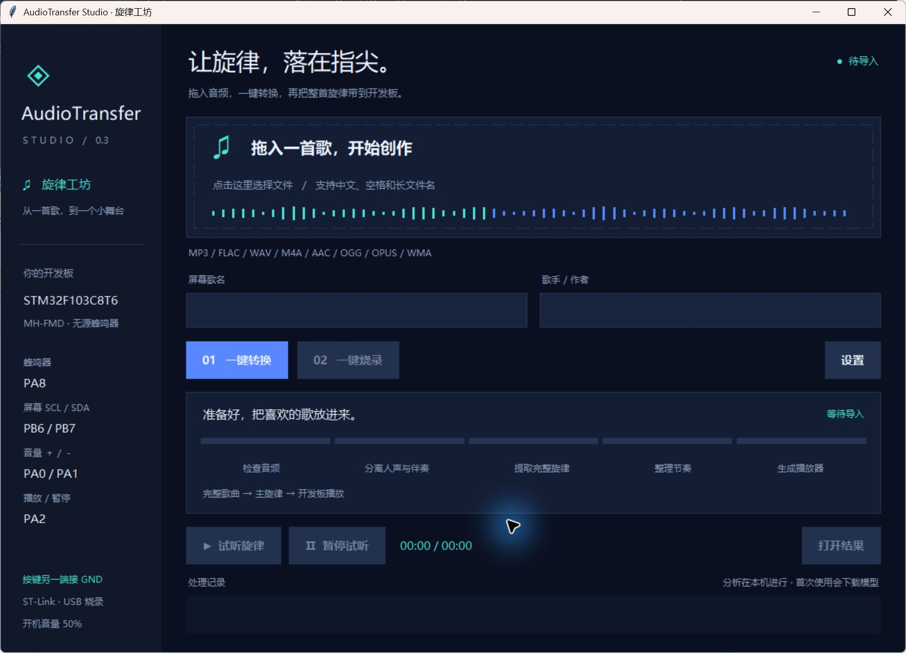

# AudioTransfer Studio

把完整歌曲（有演唱或纯音乐）提取为单声部主旋律，再生成 STM32F103C8T6 无源蜂鸣器程序。



## 使用

Windows 安装 Python 3.10 或以上版本后，先双击 `setup.bat` 安装依赖，再双击项目根目录的 **`AudioTransfer.exe`**（或 `run_gui.bat`）。EXE 是项目环境的轻量启动器，需保留在项目根目录，不包含 Python、模型和运行依赖。

1. 将 MP3、FLAC、WAV 等音频拖进窗口，也可点击选择。自动读取歌名和歌手，允许手动修改；选择“有演唱”“纯音乐”或“自动识别”。
2. 点击 **一键转换**。分段进度条显示当前阶段和耗时；分离阶段有真实百分比时同步显示，无法测量的阶段显示流光。完成后可试听、暂停或继续试听。
3. 接好 ST-Link，点击 **一键烧录**。编译、写入和校验记录实时显示，失败可重试。

桌面版默认适配本项目的 STM32F103C8T6、PA8 无源模块、SSD1306 中文屏幕及三个按键，使用音符 PWM、低电平有效、开机音量 50%，保留原速和完整歌曲。设置中可改 SH1106 或切换为单旋律跟踪。默认输出在 `out_desktop/歌名-任务编号/player/`，包含试听、MIDI、简谱、音符和可重建固件的源码。长歌名在屏幕上自动省略，元数据保留全文。

更换音频、歌名、歌手或播放设置后，需要重新转换才能烧录。每次转换独立保存，失败不会复用上一首；烧录前检查生成工程的完整性。烧录阶段会在英文临时目录编译，绕过 Windows ARM 工具对中文输出路径的限制，并将生成的 `firmware.bin` 和 `flash.log` 保存回结果目录。

“有演唱”按演唱段保护主唱，换气保留休止，独立前奏、间奏和尾奏才接入乐器。“纯音乐”全曲跟踪主奏，并合回被分离到人声轨的乐器音。“自动识别”根据整首录音的人声轨证据判断，结果会显示在转换完成处；这是启发式判断，识别不符合录音内容时应手动选择。已生成的旧结果需要重新转换才会应用新规则。

原始《茶汤》按 SHA-256 指纹匹配本仓库校对曲谱，重命名不影响识别；手动选择“纯音乐”时跳过歌曲专用校谱，其他录音走自动提取。首次使用分离模型需要联网下载，之后可在本机处理。旧版 Arduino / STM32 全参数界面仍可通过 `run_gui.bat --advanced` 打开。

也可用 `python -m pip install -e ".[song,display,desktop]"` 安装歌曲转换、屏幕与桌面功能。安装包包括内置 FFmpeg，不必单独配置 FFmpeg PATH；填写自定义 ffmpeg 路径时仍优先使用该路径。仓库不包含原曲音频、分离音轨、模型权重或本机虚拟环境。

已生成的 STM32 屏幕播放器位于 [examples/chatang-player](examples/chatang-player)，可直接用 PlatformIO 编译烧录。它包含完整《茶汤》的校谱旋律、2:50附近的间奏修正、SSD1306 OLED界面、音量与暂停按键，开机默认50%；该目录保留已编译的 `firmware/firmware.bin`。构建和实物验证状态见 `firmware/verification.json`，无需重新分离原曲即可使用。

命令行示例：

```powershell
.\run_cli.bat ".\input\song.flac" -o out_song
.\run_cli.bat ".\input\song.flac" -o out_song --content-mode vocal
.\run_cli.bat ".\input\instrumental.flac" -o out_music --content-mode instrumental
```

默认使用 STM32、全曲模式、PA8、原速 1.0、完整事件数、旋律编排和柔和发声。Arduino 用户可加 `--target arduino --pin 8`。

## 完整歌曲模式

1. 保留立体声输入，使用 Demucs 分离人声、乐器、贝斯和鼓点。
2. 默认用 CREPE 神经模型提取主唱音高；采用双阈值保留同一个音内的弱片段，过滤真正的静音和噪声，并修补有能量且两侧音高相近的短暂识别空洞。
3. 人声需要有至少 80 ms 的清楚能量与可靠音高作为乐句锚点。演唱段内可跨越最长 3.5 秒的识别空隙保护主唱声部；无可靠人声音高时保留休止，不在换气处塞入伴奏。匹配人声锚点之间，音高与能量均持续的弱延音可保留至 1 秒，实际低能量换气保留休止。弱可信度、无清楚重击且迅速返回原延音的短八度误识别会修复，高可信度的真实跳音保留。
4. 在纯音乐或独立乐器段，减弱持续伴奏，从实际频谱峰建立候选，神经音高只为有对应频谱峰的候选提供评分；通过连续路径选出主奏，不再逐帧在神经估计和频谱结果间切换。纯音乐保留真实低音独奏，不把主奏最低音域当硬删除条件。单声部输出无法保存全部和弦与多条旋律，复杂齐奏仍可能选错。
5. 使用约 100 ms 的局部音高中心和 40–80 ms 的持续确认过滤颤音，不再靠过宽的固定半音边界锁定旧音。默认最短音符 80 ms。没有真实起音、短于 160 ms、返回原延音的单半音回摆可简化；有清楚起音的短音保留。只有清晰的能量回落和重新起音，才重复同一个音。
6. 将最后一个分析跳步校准到原曲总时长；默认不裁掉尾部事件。
7. 默认分析原曲节拍，在距十六分音符网格不超过 45 ms 时整理换音边界；休止边界最多移动 25 ms。不强行将音高改成推测调式。只合并偏离节拍、没有清楚起音、符合连续滑音特征的极短中间音，保留有明确起音的短音和同音重复。
8. 只修补前后属于同一声部、音程接近、能量持续的短识别空洞。相近同音上限 220 ms，换音上限 140 ms；有真实低能量中心的换气、静音以及大跳均保留。
9. 对低音域旋律默认整体升一个八度，保持所有音程；区分连奏、真实重击和句尾。乐句采用连续的强弱走向与拍点力度，四拍重音相位仅在证据足够时估计。相同旋律和相近节奏的重复乐句/八音动机共享力度；允许一个小的旋律变体但保持其音高。`--transpose 0` 保持原音域，`--arrangement raw` 跳过节奏、音域和力度编排。

复杂和弦、合唱、乐器齐奏仍可能选错主旋律。这是自动提取的单声部近似，不能保证逐音等同人工制谱；MIDI 可供后续修正。分离出来的 `other` 轨仍可能包含多个乐器。

默认频率范围为 55–1000 Hz，可通过 `--max-frequency-hz` 扩展。CREPE 支持 50–2006 Hz 范围；超出该范围可用 `--song-backend pyin`。`--frame-ms` 主要影响轻量算法。旧 pYIN 模式的人声分析会使用至少 2048 样本窗口以容纳低音周期，乐器分析至少使用 80 ms 窗口。

`--device auto` 自动使用可用 CUDA 显卡，否则使用 CPU。可指定 `--device cpu` 或 `--device cuda`。GPU 需要与显卡匹配的 PyTorch CUDA 安装；普通安装环境也可以用 CPU 运行。模型缓存放在项目 `.models/`，已分离的音轨缓存放在输出目录 `.cache/`；桌面版在 `out_desktop/.cache/` 共享缓存，并复用同一原曲的旧任务缓存，切换歌曲类型不必重新分离。更换音频内容后会重新分离。神经模型原始音高结果也缓存在 `.models/pitch-cache/`，修改停顿、速度或最短音符时无需重复运行模型。

## 输出文件

| 文件 | 内容 |
| --- | --- |
| `melody.preview.wav` | 自动生成的一遍完整旋律试听 |
| `notes.json`、`notes.csv` | 频率、时长、音名、编排力度及连奏标记，0 Hz 为休止 |
| `melody.mid` | 可导入制谱软件的单声部 MIDI，保留实际时间 |
| `jianpu.txt` | 固定 1=C 的简谱音符时间表，含八度、升号、起始时间与实际时长，以及编排速度、移调信息 |
| `playback.json` | 固件与试听共用的发声模式、停顿设置、编排摘要和总时长 |
| `source-regions.json` | 完整歌曲的声部来源区段、所选类型和判断结果；区段时间为原始输入时间 |
| `platformio.ini`、`src/main.cpp` | STM32 Arduino Core 的 PlatformIO 工程 |
| `melody.ino` | AVR Arduino 草图 |

`--gap-ms` 表示独立起音、句尾内部的停顿上限（默认 6 ms，同时不超过音符时长的 1/5）；连奏换音不追加停顿，不会额外延长歌曲。休止符不追加间隔。试听、MIDI 时间线和固件采用相同规则。固件整曲重复之间另有 100 ms 停顿。

STM32 默认柔和发声：48 kHz PWM 载波、16 kHz 采样的正弦查表，独立起音为 12 ms、轻微衰减、句尾收音为 24 ms，短音自动缩短包络。同一乐句的连奏直接换音高，保持振荡器相位，用 8 ms 平滑力度变化，避免每个音都重新收音和起音。PA8 使用 TIM1 的 PWM，TIM2 驱动采样中断；不要再让其他功能占用这两个定时器。休止时占空比为 0，引脚保持低电平。支持 PWM 的其他引脚会自动选用对应定时器；不支持的引脚退回原方波。`--sound-mode classic` 可以明确选择原有 `tone()` 发声。柔和模式音符须低于 4000 Hz。

三针模块可显式选择 `--active-low`，休止时保持 HIGH，适用于低电平导通的驱动电路。模块丝印本身不能确认其电路极性；原默认仍为高电平驱动。`--sound-mode harmonic` 在正弦基音上加入随起音衰减的二、三次泛音；`--sound-mode pulse` 直接以音符频率输出 PWM，用脉宽变化表达起音、力度和收音，不依赖模块重建 48 kHz 载波。两种模式均保留音符时长和连奏设置，并要求 PWM 引脚和低于 4000 Hz 的音符。

本次三针模块接线为 VCC 接 3.3 V、IO 接 PA8、GND 接地。桌面版已默认选择音符 PWM 与低电平有效。旧版高级界面可选择“丰满音色”或“音符PWM”，并勾选“低电平驱动模块（HIGH关闭）”。命令行对应参数为 `--sound-mode pulse --active-low`。这是一种发声选择，不会自动修正提取错的音符。

试听会匹配所选驱动的理想音色：柔和模式模拟正弦和包络，原模式模拟方波谐波，丰满模式模拟衰减泛音，音符 PWM 模式模拟脉宽随包络变化的交流部分。蜂鸣器的共振、接线和驱动电路会影响实物声音；试听没有模拟直流分量、载波泄漏或模块频率响应，不能保证与实物响度和音色一致。

重新合成试听：

```powershell
.\.venv\Scripts\python.exe -m audiotransfer.preview out_chatang_full\notes.json --play
```

默认读取同目录 `playback.json`；`--gap-ms` 可以显式覆盖试听设置。

## STM32 构建和烧录

### OLED 屏幕和音量按键

已经生成的模块发声工程可以追加 128×64 四针 I²C OLED 播放界面。屏幕显示歌名、歌手、已播放时间／总时长、进度条、播放标记及音量百分比；时间从实际歌曲开始播放时计数，全曲循环后归零。

| 外设 | STM32 接线 |
| --- | --- |
| 屏幕 VCC / GND | 3.3 V / GND |
| 屏幕 SCL / SDA | PB6 / PB7 |
| 音量＋按键 | PA0 与 GND 之间 |
| 音量－按键 | PA1 与 GND 之间 |
| 播放 / 暂停按键 | PA2 与 GND 之间 |
| 蜂鸣器 VCC / IO / GND | 3.3 V / PA8 / GND |

按键使用内部上拉，按下导通到地；四脚按键应选取按下才导通的两组触点。0～20% 区间每次变化 1%，更高档位每次变化 5%；长按 350 ms 后每 150 ms 连续变化，0% 静音，最高 100%，开机默认 50%。两键同时按下不调整音量，变化以 20 ms 平滑施加到实际声音。使用约 60 dB 范围的电控制增益曲线，让低档位比原线性脉宽控制更轻：10% 的 Q15 控制增益从 3276 降为 65（约原来的 1/50）。这是控制信号变化，不是已校准的实物声压或听感百分比；音量不会改变音高、歌曲节奏或进度条。

音量曲线参考：[Microsoft 音频音量控制说明](https://learn.microsoft.com/windows/win32/coreaudio/audio-tapered-volume-controls)、[TI 音量控制说明](https://e2e.ti.com/blogs_/archives/b/thesignal/posts/logarithmic-potentiometers)。

```powershell
.\.venv\Scripts\python.exe -m audiotransfer.player --source out_chatang_v8_interlude -o out_chatang_player --title "茶汤" --artist "郁可唯"
pio run -d out_chatang_player -t upload
```

默认屏幕驱动为 SSD1306；若实际控制器为 SH1106，生成时加 `--controller sh1106`。程序探测地址 0x3C 和 0x3D，地址应答不能区分这两种控制器。四针标注也无法确认芯片类型。本次保留 `out_chatang_player_sh1106` 作为替代工程。可通过 `--scl PB8 --sda PB9` 使用 I2C1 另一组引脚，通过 `--volume-up` / `--volume-down` 指定按键引脚。

暂停键单击暂停，再按继续，25 ms 消抖，长按不重复触发。暂停时蜂鸣器关闭，音符计时、已播放时间和进度条冻结；恢复时继续当前音符，20 ms 渐入。暂停时仍可调音量，屏幕播放三角切为双竖线。可通过 `--pause` 指定其他未占用引脚。

新版生成的屏幕播放器将 ST-Link 的 SWD 速度设为 100 kHz；本机默认速度连接失败，降低速度后写入和校验通过。此设置影响烧录连接，不影响播放速度。

显示中文字形在生成工程时制成位图，开发板不需要完整中文字库。生成器需要 Pillow（`pip install -e ".[display]"`），默认使用 Windows 微软雅黑；其他系统通过 `--font` 指定可显示中文的字体。长歌名或歌手名称在屏幕上自动省略，JSON 中保留完整文本。

每次只传送 16 字节，刷新约四次／秒，在接近音符或收音边界时暂停传屏；I²C 事务超时为 5 ms，屏幕未连接或传输失败时继续播放，并在空余时间每三秒重试。播放器界面不需要额外 OLED 库，使用现有 STM32 Wire。`melody.preview.wav` 是原发声档位的电脑模拟，实际音量由按键控制。

显示命令参考：[Solomon Systech SSD1306 数据手册](https://www.olimex.com/Products/Modules/LCD/MOD-OLED-128x64/resources/SSD1306.pdf)、[U8g2 的 SSD1306/SH1106 驱动源码](https://github.com/olikraus/u8g2/blob/master/csrc/u8x8_d_ssd1306_128x64_noname.c)。

安装 PlatformIO 后，在项目根目录执行：

```powershell
pio run -d out_chatang_full
pio run -d out_chatang_full -t upload
```

也可以转换时追加 `--upload`。只有上传命令实际成功后才报告上传成功。默认板卡 `bluepill_f103c8`、上传协议 `stlink`、引脚 `PA8`。项目使用 Arduino Core for STM32 的 `HardwareTimer`；原方波模式使用 `tone()`。

ST-Link 的 SWDIO 接 PA13、SWCLK 接 PA14，并连接目标板 GND 和适配的 3.3 V 供电。蜂鸣器驱动电路和允许电流应按实际器件规格确定。

STM32F103C8T6 的 Flash 有限。默认保留全曲，不会为了事件上限悄悄截断。特别长或复杂的旋律需检查构建报告的 Flash 用量；`--max-notes N` 是显式裁剪选项，0 表示不裁剪。提高 `--min-note-ms` 可减少碎片音符，但也会损失短音。

## 其他参数

针对已经人工校对旋律的歌曲，可以追加 `--score-profile examples/chatang/profile.json --gap-ms 12`。当前示例只对应本次提供的 308.773 秒郁可唯《茶汤》，默认保持原曲音区；它将校对后的主歌、副歌、前奏和尾奏与原曲音高对齐。中间八小节间奏也使用参考谱，并以原曲频谱核对声部和时间：原音区为 C#4/B3/A3，175.640～192.776 秒，四分音符535.5毫秒；其余间奏空隙保留休止，不再使用原自动识别的乱跳音符。相同音高的歌词音符保留起音，延音线合并成长音，倒茶声和没有主旋律的伴奏处休止。这是歌曲专用的校谱入口，普通转换仍然采用自动识别，不能保证任意完整伴奏歌曲都达到同样准确度。

已有同一原曲的分析缓存及旧版音符时，可以快速重新生成本次校谱版：

```powershell
.\.venv\Scripts\python.exe -m audiotransfer.scored_song --profile examples/chatang/profile.json --baseline examples/chatang/baseline-v5.json --analysis examples/chatang/song-analysis.npz --output out_chatang_v8_interlude --transpose 12 --sound-mode pulse --active-low
```

校谱参考：[《茶汤》简谱](https://www.jianpujia.com/jianpu/154500.html)。音高和时间通过输入原曲再校核，`alignment.json` 记录各段对齐结果。可靠音高吻合率仅是分析诊断，不是实际听感评分。

复调间奏的旧单声部音高缓存不适合直接作对齐基准。已核对的段落可显式填写 `reviewed_alignment.offset_seconds` 和 `quarter_seconds`，仍检查相邻段落重叠与原曲边界；此入口只消费明确的歌曲校谱参数，不自动猜测谱子。间奏的频谱支持诊断表示预定三音集合内的能量支持，不能当成逐音准确率。需要生成当前模块声部时，可在 `audiotransfer.scored_song` 命令追加 `--transpose 12 --sound-mode pulse --active-low`，再通过 `audiotransfer.player` 添加屏幕；播放器仍开机默认50%。

- `--song-backend pyin`：显式使用旧版 pYIN 人声音高识别与轻量乐器跟踪。
- `--sound-mode soft` / `harmonic` / `pulse` / `classic`：柔和发声 / 衰减泛音 / 音符频率 PWM / 原方波，STM32 自动模式默认柔和。
- `--active-low`：STM32 模块低电平导通，休止 HIGH；按实际驱动电路选择。
- `--arrangement score` / `--arrangement raw`：旋律编排 / 原始识别，默认编排。
- `--transpose 0`：编排时保留原音域；可指定 -36 到 36 个半音。
- `--pitch-mode tracked`：不分离音轨的轻量跟踪模式。
- `--pitch-mode legacy`：逐帧单音算法，适合单独的乐器或测试音。
- `--speed 1.25`：加快播放；默认 1.0。
- `--min-note-ms 80`：平滑短音阈值。
- `--hop-ms 20`：分析时间步长。
- `--energy-threshold 0.01`、`--confidence-threshold 0.35`：能量和可靠性阈值。
- `--candidate-count 5`、`--tracking-min-frequency-hz 140`：轻量/乐器跟踪的候选数和优先音区下限；不会硬切除所有低音。

## 验证

本次类型选择、主旋律保护和实板烧录记录见 [0.3.1 验证记录](docs/validation-v0.3.1.md)；暂停键与音量的已有实板记录见 [0.3 验证记录](docs/validation.md)。

```powershell
.\.venv\Scripts\python.exe -m unittest discover -v -s tests
```

测试包括 GUI 启动、边界音和低音、噪声过滤、重复音、时长一致性、错半音锁定、短回摆与真实起音、辅音空洞与真实换气、人声泄漏、持续伴奏中的弱旋律、连奏音频、重复乐句和真实变体、力度导出、柔和模拟的谐波与静音，以及“前奏乐器—主唱—尾奏乐器”的完整时间线。模型分离和实际 STM32 构建还需要单独验证。

算法参考：[Demucs](https://github.com/adefossez/demucs)、[torchcrepe](https://github.com/maxrmorrison/torchcrepe)、[librosa pYIN](https://librosa.org/doc/0.11.0/generated/librosa.pyin.html)。
节拍和 PWM 接口：[librosa beat_track](https://librosa.org/doc/0.11.0/generated/librosa.beat.beat_track.html)、[STM32 HardwareTimer](https://github.com/stm32duino/Arduino_Core_STM32/wiki/HardwareTimer-library)。
